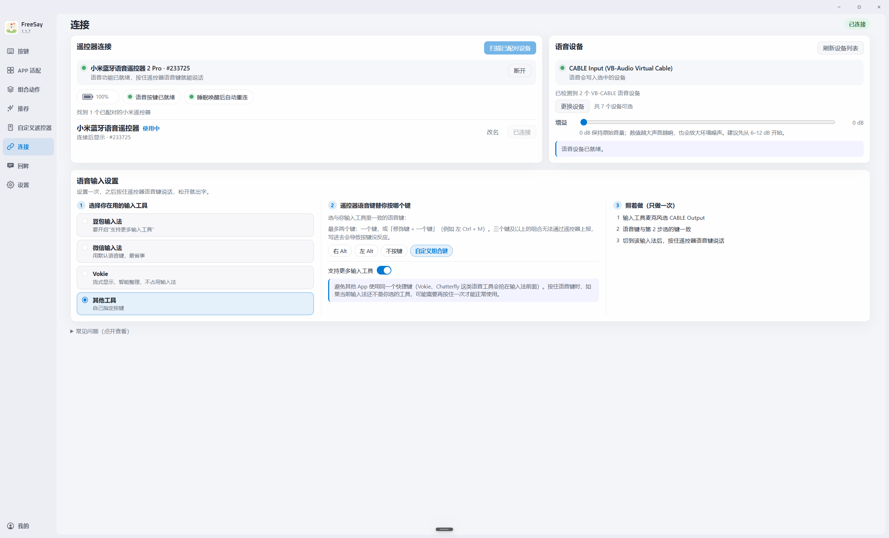
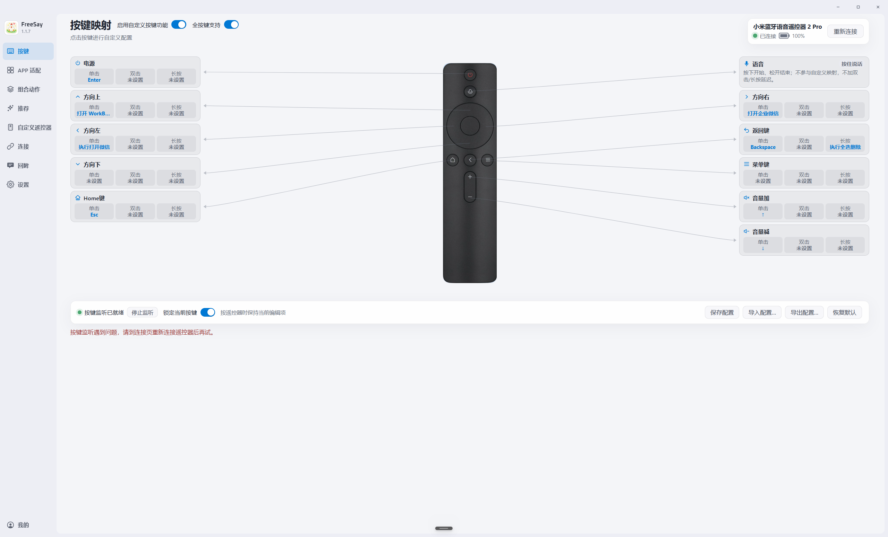
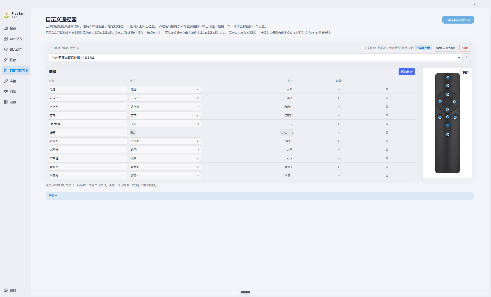
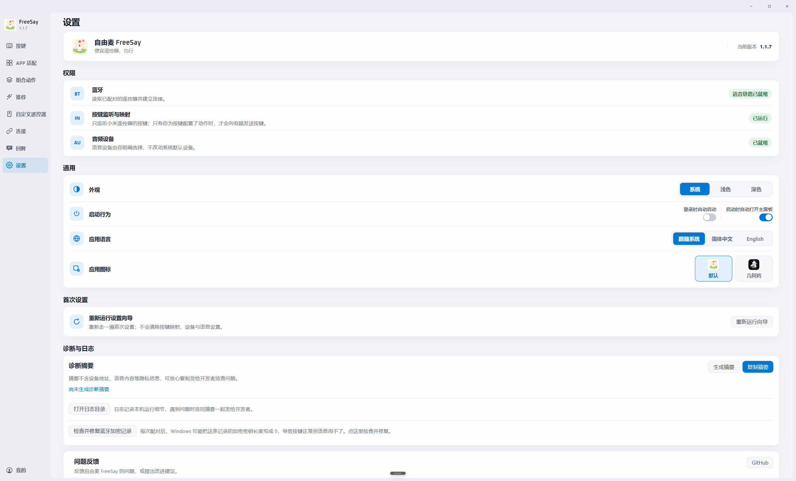

# <p align="center">自由麦 FreeSay for Windows</p>

<p align="center">
把蓝牙语音遥控器变成电脑的无线麦克风与快捷键面板
</p>

<p align="center">


</p>

<p align="center">
<a href="https://github.com/guiyko/FreeSay/releases/latest">下载安装包</a> ·
<a href="docs/installation-and-configuration.md">安装与配置指南</a> ·
<a href="docs/ui-guide/README.md">界面与功能说明</a> ·
<a href="https://github.com/guiyko/FreeSay/releases">更新记录</a>
</p>

---

## 项目介绍

按住遥控器上的语音键说话，文字直接落进当前输入框；松开即结束。遥控器上的按键可以映射成快捷键、组合动作，或用来打开某个应用——把一支几十块钱的蓝牙语音遥控器，变成电脑的麦克风与快捷键面板。

它解决的是这类设备在 Windows 上的两个老问题：

- **语音键不是键盘按键**，输入法收不到，需要有人替它“按住”一个键；
- **返回 / 音量± / 电源等键被系统丢弃**，映射工具根本看不见它们。

FreeSay 在驱动层之外补上这两段链路：语音键转成输入法认识的快捷键，系统丢弃的按键由提权助手在 HID 报告层截获。



## 支持哪些遥控器

| 类型 | 支持情况 | 接入方式 |
|---|---|---|
| 小米蓝牙遥控器 2（RC001） | 内置适配，真机验收 | 连上即可用，布局与按键开箱预置 |
| 小米蓝牙遥控器 2 Pro（RC003） | 内置适配，真机验收 | 同上 |
| **其它普通蓝牙语音遥控器** | **可用**，需一次性配置 | 走蓝牙 ATVV 语音协议；在「自定义遥控器」上传照片、给按键起名选键位，即可获得与内置型号一致的卡片式布局 |
| 普通蓝牙（非语音）遥控器 | 按键可用，无语音 | 同上，但只有按键映射 |

> 语音能力取决于设备是否提供 ATVV 语音服务（大多数电视/盒子配套的蓝牙语音遥控器都有）。设备若同时被电视占用，请先关掉那台设备的蓝牙。

## 核心能力

**语音输入**

- 按住说话，松开出字；支持豆包输入法、微信输入法、Vokie 等语音工具，选中工具后应用自动配好快捷键与准备步骤。
- 语音走虚拟声卡（VB-CABLE），与输入法解耦：换输入法不用改遥控器。
- 可选增益（0–24 dB），安静环境可提升识别率。

**按键映射**

- 每个按键的单击、双击、长按分别配置，可映射为快捷键、组合动作或打开应用。
- **全按键支持**：返回、音量+、音量−、电源等遥控器专有按键也能自定义，只需授权一次。
- 卡片可拖动：按住卡片上下移动、拖过中线换列，间距由布局统一计算。

**自定义遥控器**

- 上传照片 → 给按键起名、选键位、在照片上标点，按键页即用同一张照片渲染卡片。
- 新建即预置 12 个键位（含电源），不会因为漏配某个键而“按了没反应”。
- **只维护一只自定义遥控器**：名称就地在顶部改（失焦转灰、再点继续编辑），按键数、绑定状态与「设为当前 / 复制内置配置 / 删除」都在同一行，没有列表要管。
- **照片按原始比例完整显示**：照片区高度固定、宽度随比例自适应，长条遥控器不会被裁切或压扁。

**稳定性与运维**

- 自动记住遥控器与语音设备，断连、睡眠唤醒后自动恢复。
- **蓝牙加密记录自愈**：配对后 Windows 可能把该设备的加密密钥长度写成 0，导致“按键正常、语音静默”。设置页可一键检查并修复，无需删设备重配。
- 诊断摘要与本地日志：出问题时可一键导出（不含设备地址与语音内容）。
- **推荐页离线内置**：遥控器与输入法的搭配建议随应用打包，不联网加载，断网也能看。
- **删除已配对遥控器会拦一道**：应用检测到已配对的遥控器被删除后，会提示先重启电脑再去蓝牙里连新遥控器——不重启直接连，新遥控器很可能连不上。

## 快速开始

1. **安装**：从 [Releases](https://github.com/guiyko/FreeSay/releases) 下载 `x64-setup.exe` 安装（首次运行可能出现 SmartScreen 提示，确认来源后继续）。
2. **装虚拟声卡**：从 [VB-Audio](https://vb-audio.com/Cable/) 安装 VB-CABLE，装完重启电脑。
3. **配对遥控器**：Windows 设置 → 蓝牙 → 添加设备，同时长按遥控器的「菜单 + 主页」直到指示灯快闪。
4. **配置语音**：打开 FreeSay → 连接页扫描并连接 → 选语音工具与「替你按下的键」→ 按第 ③ 步把输入法麦克风设为 `CABLE Output`。

细节见 [安装与配置指南](docs/installation-and-configuration.md)；不想手动折腾，可用下面的 AI 一键安装提示词。

## 界面一览

| 按键映射 | 自定义遥控器 |
|---|---|
|  |  |

| 设置 | 连接 |
|---|---|
|  |  |

完整说明（每个区块能做什么、为什么这么设计）见 [docs/ui-guide/README.md](docs/ui-guide/README.md)。

## 常见问题（摘要）

- **按键有反应、语音没声音或提示“发现 ATVV 特征返回状态 3”**：Windows 蓝牙绑定记录里的加密密钥长度被写成 0。到「设置 → 诊断与日志」点「检查并修复蓝牙加密记录」。
- **不要用“删除设备 → 重新配对”修语音**：每配对一次都会把该记录重新写成 0，往往越修越坏。
- **在 Windows 里删掉了一支已配对的遥控器**：先重启电脑，再去蓝牙里连新的。应用检测到删除后会直接把「连接 / 扫描 / 设为当前 / 绑定」置灰并给出提示，重启后自动恢复。
- **切换遥控器**：在自定义遥控器页点「设为当前」，应用会自动断开当前并连接目标；目标无反应先按一下它任意键唤醒。
- **返回 / 音量± / 电源录不进快捷键**：这些键由增强捕获读取，录入前先点「设为当前」。
- **输入法不出字**：确认输入法麦克风是 `CABLE Output`；微信输入法需按住约半秒；豆包必须是当前输入法。

更多见连接页「常见问题（点开查看）」。

## AI 一键安装（Agent 提示词）

不熟悉 Windows 设置也可以：把下面这段提示词整段复制给豆包、DeepSeek 等 AI，它会先确认电脑和遥控器是否符合要求，再一步一步带你安装、配对、设置语音输入，最后验证能不能出字。

- 能操作电脑的 AI 可以直接完成检查、下载和安装中能自动完成的部分；只能聊天的 AI 会告诉你每一步点哪里。
- 需要你本人确认的步骤（安装 VB-CABLE 和开启“全按键支持”时 Windows 弹出的询问、SmartScreen 提示、蓝牙配对、重启电脑）它会停下来等你。
- 安装包只从官方 [GitHub Releases](https://github.com/guiyko/FreeSay/releases) 下载。任何让你关闭 SmartScreen、杀毒软件或系统安全设置的说法都不要照做。

<details>
<summary><strong>点开复制「FreeSay 一键安装」提示词</strong></summary>

```text
你是我的 Windows 安装向导。请用简单的中文，少用术语；必须用时先用一句话解释。一步一步帮我在当前这台电脑上安装并配置「自由麦 FreeSay Windows 版」，直到我用遥控器说话能真正打出字。

开始前先说明你的能力：如果你只能聊天，不要假装执行命令，只告诉我点哪里、输入什么，然后等我回复结果；如果你能操作这台电脑，可以先做检查、下载和安装，但每次动手前先说明要做什么，得到我同意再做。

产品事实：
- 支持 64 位 Windows 10 1809（内部版本 17763）或更高版本。ARM64 电脑上，基础语音和按键可用，“全按键支持”需要安装包带 arm64 组件；官方最新安装包已包含。如果应用提示缺少组件，重新安装本版本。
- 内置适配小米蓝牙语音遥控器 2（RC001）与 2 Pro（RC003）；其它符合蓝牙 ATVV 语音协议的普通蓝牙语音遥控器，可在「自定义遥控器」里上传照片、标定按键后使用。
- 安装包优先从官方 GitHub Releases 下载：https://github.com/guiyko/FreeSay/releases。选最新的预览版（或最新正式版），文件名是 FreeSay_<版本号>_x64-setup.exe。不要下载 latest.json 或 .sig，也不要从软件站或搜索结果里的其他地址找安装包。
- 如果 GitHub 打不开，停下来告诉我，我会告诉你从项目 README（https://github.com/guiyko/FreeSay）里的 Releases 页面下载。
- 官方安装指南：https://github.com/guiyko/FreeSay/blob/main/docs/installation-and-configuration.md
- 这份提示词和官方安装指南冲突时，以官方安装指南为准。
- 不需要为了安装额外下载 SHA256SUMS.txt，也不需要让我手动运行 PowerShell。从官方 Releases 直接下载的安装包可以直接安装；如果从其他渠道拿到安装包，能核对 SHA-256 就核对；哈希不一致时停止安装。
- 如果 Windows 提示“Windows 已保护你的电脑”，确认安装包来自上面的官方 Releases后，才让我点“更多信息 → 仍要运行”。不要让我关闭 SmartScreen、杀毒软件或任何安全设置。
- FreeSay 按当前用户安装，日常不要用管理员身份运行。安装 VB-CABLE 和开启“全按键支持”时，Windows 会弹出授权询问；这些由你本人确认。

请按这个顺序做。每一步先告诉我目的和怎样算完成，再给操作；我确认后再进入下一步：
1. 检查系统：Windows 版本、是否 64 位、蓝牙是否已打开、网络是否可用、遥控器是否在身边且电池有电。
2. 下载安装包并安装 FreeSay。不需要额外下载校验文件，也不需要让我手动运行 PowerShell；如果你自己能核对 SHA-256 就核对，不能核对就直接安装。安装时让我看到安装界面并自己点下一步，不要静默安装。
3. 配对遥控器：打开 Windows“设置 → 蓝牙和设备 → 添加设备 → 蓝牙”（Windows 10 是“设置 → 设备 → 蓝牙和其他设备”），同时长按遥控器的“菜单 + 主页”键，直到它出现在列表里；没反应就按遥控器说明书进入配对模式，不要反复快速按键。遥控器如果还连着电视或盒子，先关掉那台设备的蓝牙。配对由我本人操作。
4. 如果要用遥控器说话：从 https://vb-audio.com/Cable/ 下载 VB-CABLE，解压后右键 VBCABLE_Setup_x64.exe，选择“以管理员身份运行”，再选择 Install Driver；完成后重启电脑。Windows 弹出的询问和重启由我本人确认。
5. 打开 FreeSay，跟随首次设置向导；如果没有向导，打开“连接”页，扫描并连接遥控器，确认显示 RC001 或 RC003；如果要用遥控器说话，语音设备选择带“推荐”标记的 CABLE 播放端（CABLE Input 或 CABLE In 16 Ch）。
6. 配置语音输入：如果还没选，先问我在用哪个工具（豆包输入法、微信输入法、Vokie 或其他）。按 FreeSay“语音输入设置”的第 ③ 步准备；用豆包时必须在第 ② 步打开“支持更多输入工具”。麦克风选 CABLE Output。豆包和 Vokie 都用右 Alt，二者只开一个。
7. 验证：按住遥控器语音键说话，松开后看当前输入框有没有出字。没有出字时，按 FreeSay 页面上的提示排查；连接异常先等约 60 秒自动恢复，不要先重启电脑、重启蓝牙或重新配对。
8. 基础语音通过后，再问我要不要设置按键映射。“支持更多输入工具”和按键页的“全按键支持”是同一个开关：豆包路径已经在第 6 步打开，不要再重复开关；其他工具需要时再开启。第一次开启时 Windows 会弹出一次授权询问，选“是”，之后开关都不用再授权。

必须遵守：
- 只在 FreeSay 的可见界面里配置，不要直接改它的设置文件，也不要读写其他软件的私有配置、数据库或内存。
- 不要读取、记录或发送我的蓝牙地址、设备路径、语音内容或个人路径。
- 不要替我做 Windows 弹出的询问、SmartScreen、蓝牙配对和重启电脑；这些必须由我本人确认。
- 不要安装来源不明的软件或脚本。
- 最后告诉我：FreeSay 版本、遥控器型号、连接 / 语音按键 / 语音设备 / 按键监听四项是否“已就绪”、实际出字是否成功，以及还有哪些步骤没完成。
- 做不到的步骤直接说“这一步需要你来做”，给出具体点击位置，不要跳过，也不要假装成功。
```

</details>

## 兼容性与已知限制

- Windows 10 1809（17763）及以上，64 位。ARM64 上基础语音与按键可用，“全按键支持”需要安装包携带 arm64 组件。
- 语音依赖 VB-CABLE 虚拟声卡；未安装时只能使用按键映射。
- 返回 / 音量± / 电源的**快捷键录入**需要先「设为当前」（助手只 hook 目标设备的宿主进程）。
- 安装包尚未做 Windows 代码签名，首次运行可能触发 SmartScreen。
- 蓝牙加密记录可能在下次配对后再次被系统写坏，届时再点一次修复即可。

## 请我买杯 Token

如果这个项目帮你省下了时间，可以自愿支持一点 AI Token 费用。这些支持会用于继续开发新功能、修问题、维护文档。

- **完全自愿**，不影响软件的任何功能，也不构成服务承诺；
- 金额随意，量力而行；
- 无论是否支持，都感谢你的使用与反馈。


<p align="center">

</p>

</details>

## 参与开发

开发环境、构建与本地检查流程见 [DEVELOPMENT.md](DEVELOPMENT.md)。仓库内的只读诊断探针位于 `crates/sayall-windows/examples/`（如 `atvv_char_probe`、`gatt_baseline_probe`），用于排查蓝牙链路问题。

## 来源与许可

本项目基于 [GetSayAll/remote-mic-app-windows](https://github.com/GetSayAll/remote-mic-app-windows)（GPL-3.0）衍生开发，在其基础上重做了 Windows 端的语音按键链路，并新增自定义遥控器、按键卡片拖动等能力。原项目版权归其作者所有；本仓库的修改部分同样以 GPL-3.0 授权，详见下方开源协议。

程序代码使用 GPL-3.0-only。App Logo 和 App Icon 是保留版权的专有品牌资产，不属于 GPL-3.0-only 授权范围；详见 [LOGO-LICENSE.md](LOGO-LICENSE.md)。第三方来源与素材边界见 [ATTRIBUTION.md](ATTRIBUTION.md) 和 [THIRD_PARTY_NOTICES.md](THIRD_PARTY_NOTICES.md)。
