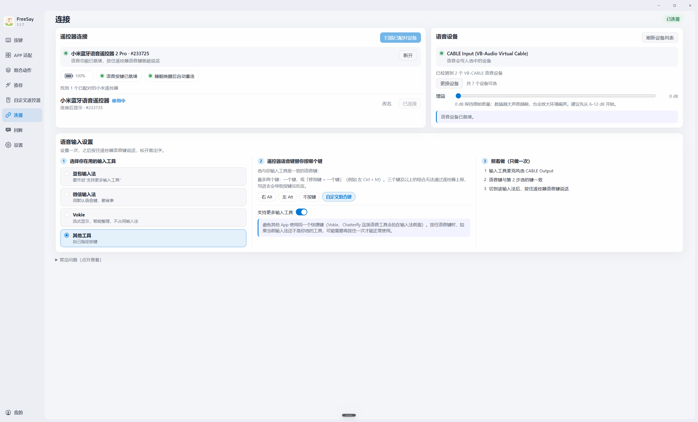
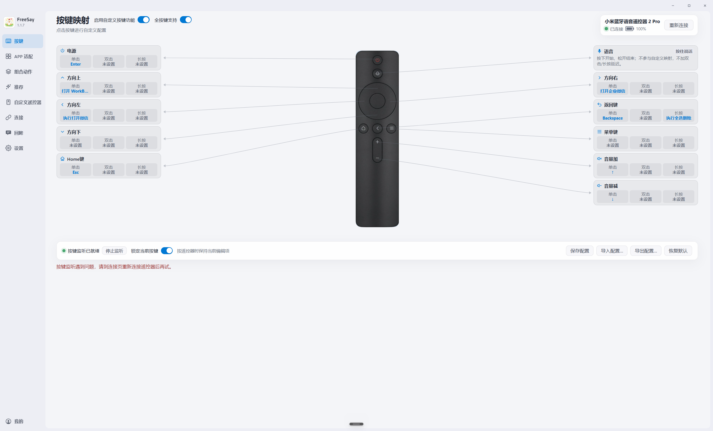
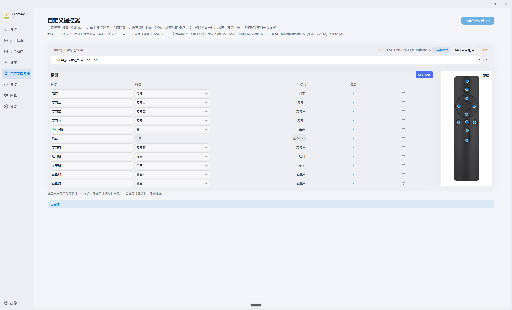
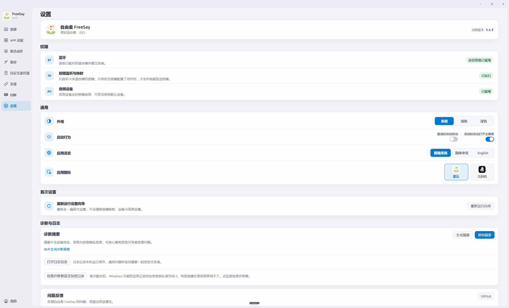

# 自由麦 FreeSay 1.1.7 · 界面与功能说明

> 一个把「小米蓝牙语音遥控器」变成电脑无线麦克风 + 快捷键面板的 Windows 应用。
> 按住遥控器语音键说话，文字直接落进输入框；遥控器上的按键可以映射成快捷键、组合动作或打开应用。
>
> - 版本：**1.1.7**
> - 安装包：`FreeSay_1.1.7_x64-setup.exe`（21.6 MiB，NSIS，Windows x64）
> - 截图取自本机运行版（实机界面，非示意图）

---

## 一、主界面：连接

界面为左右两栏：左侧是固定导航（按键 / APP 适配 / 组合动作 / 推荐 / 自定义遥控器 / 连接 / 回眸 / 设置 / 我的），右侧是当前页内容。左上角显示产品名与版本号，右上角是全局连接状态（截图里为「已连接」）。

### 1. 遥控器连接

- **已连接的遥控器卡片**：显示设备名 + 别名、电池电量（100%）、能力标签（「语音按键已就绪」「睡眠唤醒后自动重连」），右侧是「断开」。
- **设备列表**：列出本机所有已配对遥控器，并标注「使用中」与令牌尾号（如 `#233725`、`#5cd7ea`）。
  两支同型号遥控器名字完全一样，令牌尾号与「改名」就是用来区分它们的。
- **扫描已配对设备**：重新枚举系统里已配对的设备。设备刚配对完、或刚在系统里删掉时用它刷新。

### 2. 语音设备

- 显示选中的音频端点（截图里是 `CABLE Input (VB-Audio Virtual Cable)`），说明「语音会写入选中的设备」。
- **增益**滑杆：默认 0 dB。建议从 6–12 dB 开始往上加，太大也会放大环境底噪。
- 底部一行状态反馈（「语音设备已就绪」），出问题时这里会给出具体原因。

### 3. 语音输入设置（一次配好，长期有效）

三步向导式布局：

1. **选择你在用的输入工具**：豆包输入法 / 微信输入法 / Vokie / 其他工具。
   前三种是「应用替你按它自己的语音快捷键」，最省事；「其他工具」需要你自己指定按键。
2. **遥控器语音键替你按哪个键**：右 Alt / 左 Alt / 不按键 / 自定义组合键。
   **最多两个键**——三个及以上组合无法通过遥控器报告层上报，写进去会导致按键无反应。
3. **照着做（只做一次）**：给输入工具选麦克风为 `CABLE Output` → 记下它的语音快捷键 → 切到该输入法后按住遥控器语音键说话。

底部「常见问题（点开查看）」收录了 12 条现场经验，包括本轮新增的 5 条（见第六节）。

---

## 二、按键映射

顶部两个开关：「启用自定义按键功能」与「全按键支持」。后者会让返回 / 音量± / 电源这类系统不认的键也能被接管，第一次开启需要一次系统授权。

- 中间是**遥控器外形 + 按键卡片**的联动视图：每张卡片对应遥控器上的一个物理键，卡片内按「单击 / 双击 / 长按」三种手势分别配置。
  卡片之间的灰色弧线表示该键在遥控器上的位置关系。
- 未上传照片时，中间显示占位提示；上传照片后这里会按真实比例显示遥控器外观。
- 右上角是当前遥控器状态（名称、已连接、电量、「重新连接」）。
- 底部状态栏：按键监听状态、「停止监听」、锁定当前按键、全局操作（保存配置 / 导入 / 导出 / 恢复默认）。

---

## 三、自定义遥控器

用于「不是内置型号」的遥控器：上传你自己的遥控器照片，把按键标在照片上，之后按键页就按这张图展示与配置。

- **顶部信息行**：遥控器名称（就地编辑：失焦转灰只读，再点继续改）、「N 个按键 · 绑定状态」、以及「设为当前 / 复制内置配置 / 删除」；下一行是「绑定的遥控器」下拉与刷新。
- **右侧照片区**：高度固定、宽度随图片原始比例，整支遥控器完整显示，不裁切不压扁；「上传 / 更换照片」在照片区右上角。
- **按键表格**：名称、键位（电源 / 方向上 / 方向左 / 返回 … 共 12 个预设）、核对、位置（标点）、删除，五列全部可见，无横向滚动。
- 表格下方一行小字说明：「键位只决定图标与统计；实际按下的键由「核对」决定；语音键走「连接」页的快捷键」。

**规则（1.1.7）**：只维护**一只**自定义遥控器，页面不再有列表卡片；新建时自动预置与内置型号一致的 12 个键位，不会漏键。

---

## 四、设置

- **应用信息**：版本号（1.1.0）与更新通道状态。
- **权限**：蓝牙（语音链路是否就绪）、按键监听与映射（是否运行）、音频设备（是否就绪）——三行都是实时状态灯，出问题先看这里。
- **通用**：外观（系统 / 浅色 / 深色）、启动行为（登录时自动启动、启动时自动打开主面板）、应用语言（跟随系统 / 简体中文 / English）、应用图标。
- **首次设置**：可重新运行向导，不会清除按键映射、设备与语音设置。

---

## 五、诊断与日志（含蓝牙加密记录修复）

> 这一区在「设置」页底部（截图见上一节的设置页）。

这一区是反馈问题的取证入口，包含三项能力：

1. **诊断摘要**：点「生成摘要」得到当前运行状态快照（Windows 版本、平台能力、连接与音频快照、映射引擎计数等），点「复制摘要」一键取走。
   摘要**不含**设备地址、设备名、音频端点真实路径与语音内容，可以放心发给开发者。
2. **打开日志目录**：日志在本机 `%LOCALAPPDATA%\SayAll\Logs\`，单文件约 10 MB 自动轮转，记录完整运行细节（连接阶段、ATVV 控制帧、推流速率、绑定修复等）。
   **不上传、无遥测**，只有你自己复制或发送。
3. **检查并修复蓝牙加密记录**（1.1.0 新增）：这是本轮最重要的一项。

### 为什么需要它

Windows 每次完成蓝牙配对，都可能把该设备绑定记录里的 `KeyLength`（加密密钥长度）写成 **0**。后果是链路没有可用加密：

- **按键完全正常**（HID 不需要这条加密通道）；
- **语音不可用**，界面提示「发现 ATVV 特征返回状态 3」，虚拟声卡没有电平。

这个值不是用户能看到的，也不是「设备坏了」。点这个按钮后应用会：读取该设备的 `KeyLength` → 若为 0 且密钥有效则改回 16 → 重启蓝牙服务让内核重新加载 → 提示结果。

结果的 10 种取值都会翻成一句可执行的中文，例如「蓝牙加密记录正常，无需修复」「已修复并重启蓝牙服务，请重新连接后测试语音」「记录已修复但服务没能重启，请重启电脑」「绑定已损坏（密钥为空），需要重新配对」。

> 重要：**不要用「删除设备 → 重新配对」来修语音问题**。每配对一次都会把该记录重新写成 0，往往越修越坏。

---

## 六、1.1.0 更新要点

| 模块 | 变更 |
|---|---|
| 自定义遥控器 | 最多 1 个；新建不再要求删系统设备；新建预置 12 键；删除后按「内置优先」回退连接（只断连、不解配对） |
| 切换一致性 | 布局与按键配置以「当前实际连接的设备」为唯一依据；「设为当前」自动断开当前并连接目标；半死会话不再被原样复用 |
| 按键配置 | 按遥控器分档案，A 配的快捷键不再串到 B |
| 蓝牙绑定自愈 | 新增「检查并修复蓝牙加密记录」；连接失败命中「拒绝访问」时自动修一次再重连；连接页错误提示加「立即修复」 |
| 文案与文档 | 删除已证伪的「两支不能同时用语音、要删另一支重配」；常见问题补 5 条现场经验 |
| 版本 | 1.0.4 → **1.1.0** |

### 常见问题新增的 5 条

1. 按键正常、语音报状态 3 → 是加密记录被写坏，用诊断页修复，不要删设备重配；
2. 明确不要靠「删设备重配」修语音（越修越坏）；
3. 切换遥控器点「设为当前」即自动断开并连接；目标无反应先按一下任意键唤醒；
4. 返回 / 音量± / 电源由增强捕获读取，录入它们的快捷键前必须先「设为当前」；
5. 两支同型号可同时配对、互不影响，语音只跟随当前连接的那一支。

---

## 七、已知限制

- **报告层按键（返回 / 音量± / 电源）的录入**需要先「设为当前」：助手只 hook 目标设备的宿主进程，切换后才能读到这些键。
- **蓝牙加密记录仍可能被系统再次写坏**：修复是即时生效的，但下次配对后可能复发，届时再点一次修复即可。
- **arm64 未出包**：本次仅 x64 安装包；Windows 11 ARM64 上会明确提示「全按键支持」不可用。
